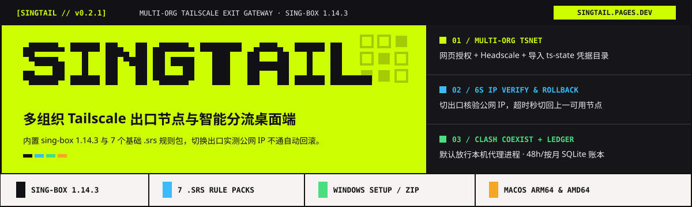
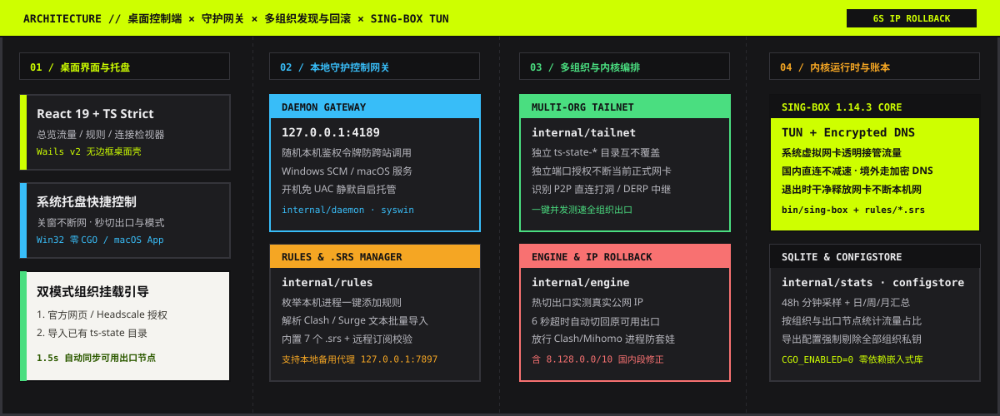
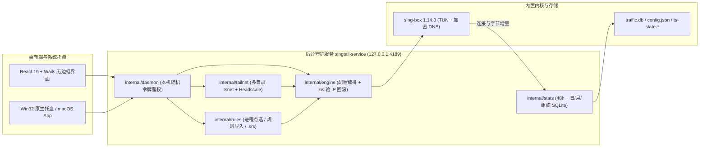

<div align="center">

<a href="https://singtail.pages.dev">
  
</a>

<br />

 &nbsp; **SingTail** — 多组织 Tailscale 出口节点与智能分流桌面端 · Multi-Org Tailscale Exit Gateway

[](https://singtail.pages.dev)
[](https://github.com/SagerNet/sing-box)
[](https://go.dev/)
[](https://github.com/evepupil/SingTail/releases)
[](#下载与使用)
[](LICENSE)

面向自建 Tailscale 出口节点用户的 Windows / macOS 桌面客户端：把多组织接入、出口测速热切、国内外智能分流与 SQLite 流量统计整合成开箱即用的图形界面，内置 `sing-box 1.14.3` 内核与 7 个基础 `.srs` 规则包。

[项目官网](https://singtail.pages.dev) · [核心优势](#核心优势) · [架构与原理](#架构与原理) · [下载与使用](#下载与使用) · [本地开发与构建](#本地开发与构建) · [隐私与安全](#隐私与安全)

</div>

---

## 为什么需要 SingTail？

自建 Tailscale 出口节点虽然比第三方机场更稳、更可控，但日常在桌面端主力使用往往会遇到几道门槛：

- **多组织账号割裂**：官方客户端一次只能挂一个 Tailnet，同时使用个人节点与公司/团队节点时不得不反复注销重登，或自己折腾脚本。
- **盲切出口容易断网**：手动换出口时如果对方节点刚好掉线或上游不通，页面直接卡死断流，还要人工再切回去。
- **手改分流配置与网卡冲突**：自己维护 `sing-box` JSON 容易漏掉 DNS 防污染、误拦内网，或者和本机原本在跑的 Clash / Mihomo 虚拟网卡互相抓包套娃。

**SingTail 的解法**：用纯 Go 零 CGO 守护服务托管官方 `sing-box 1.14.3` 内核与多个独立目录的 `tsnet` 实例，在 React 19 + Wails 桌面工作台和原生系统托盘里把多组织聚合、6 秒验 IP 自动回滚、可视化规则、进程点选与多粒度流量账本一次配齐。

---

## 核心优势

1. **多组织出口自动发现与双模式接入**
   同时挂载个人 Tailnet 与公司/团队等多个 Tailscale 组织，支持通过官方网页扫码/点击授权登录（含自建 Headscale 控制地址），也支持直接导入本机已有的 `ts-state` 凭据目录；各组织登录状态分目录独立保存、互不覆盖，新增组织在独立端口拉起授权页，授权期间不断当前正式虚拟网卡，登录后自动汇总所有开启出口权限（Exit Node）的远端机器、P2P 直连或 DERP 中继状态与实时延迟，点一下即可跨组织切换。

2. **切换出口自动验 IP，6 秒不通自动回滚**
   每次切换出口节点时，后台自动通过本地混合代理端口核验实际公网出口 IP；如果节点超时或未生效，立即自动切回上一个可用出口并弹出横幅提醒，避免误切导致断网。

3. **国内外防污染精准分流与规则导入**
   内置开箱即用的分流底盘与 7 个基础 `.srs` 规则包：国内常见域名、国内 IP 段（含阿里云 `8.128.0.0/10` 修正段）和本机局域网直连不减速，境外域名自动经出口走加密 DNS 解析；支持直接点选电脑里正在运行的程序（如浏览器、游戏、IDE）一键加规则，也支持导入外部规则文本与 `.srs` 规则集订阅定时更新（先下临时目录校验格式合法后再原子替换）。

4. **与 Clash / Mihomo 无感共存**
   底层默认自动放行 `tailscaled.exe`、`verge-mihomo.exe`、`clash-verge.exe` 等本机常见代理客户端进程，防止虚拟网卡互相抓包套娃；同时支持填写一个本地备用代理端口（例如 `127.0.0.1:7897`），把特定域名单独分流给备用线路。

5. **多粒度历史流量与组织节点分布**
   基于轻量嵌入式 SQLite 账本（`CGO_ENABLED=0`），保留最近 48 小时分钟级明细并自动归并历史汇总，支持按「实时 / 今日 / 近 7 天 / 近 30 天 / 按月」查看上下行趋势曲线，以及各 Tailscale 组织、各出口节点的流量占比排行。

---

## 架构与原理



<details>
<summary>查看 Mermaid 文本版架构图</summary>



</details>

---

## 下载与使用

每次发布都会在 [GitHub Releases](https://github.com/evepupil/SingTail/releases/latest) 同时提供 Windows 与 macOS 共四份内置 `sing-box 1.14.3` 内核及 7 个基础 `.srs` 规则包的正式产物，按系统与习惯任选其一即可：

### Windows 方式一：标准安装包（推荐日常使用）

下载 `SingTail-windows-amd64-setup.exe` 并双击运行安装向导：
- 自动将程序、内置 `bin/sing-box.exe` 内核与 `rules/*.srs` 规则包安装至 `Program Files\SingTail`，并创建桌面与开始菜单快捷方式；
- 自动注册并启动 `SingTailService` 系统后台服务，开机免弹 UAC 框静默驻留，关闭窗口不断网；
- 需要卸载时，在系统「应用和功能」或开始菜单点击卸载即可自动停止并清理服务、内核与规则目录。

### Windows 方式二：绿色便携包（免安装解压即用）

下载 `SingTail-windows-amd64-portable.zip`，解压到任意目录即可使用：
- 压缩包内已包含 `singtail.exe`、`singtail-service.exe`、`bin/sing-box.exe` 与 `rules/*.srs`；
- 直接双击 `singtail.exe` 启动桌面客户端（未安装系统服务时，桌面端会自动拉起内置守护服务）；
- 如希望作为 Windows 后台服务开机静默自启，请右键以管理员身份运行目录内的 `install-service.bat`；
- 如需移除后台服务，右键以管理员身份运行 `uninstall-service.bat`。

### macOS 方式：DMG 镜像安装包（Apple Silicon / Intel）

根据芯片架构选择下载：
- Apple Silicon（M 系列芯片）：`SingTail-macos-arm64.dmg`
- Intel 芯片：`SingTail-macos-amd64.dmg`

安装与使用步骤：
- 双击打开 `.dmg` 镜像，将 `SingTail.app` 拖入右侧 `Applications` 快捷方式（`SingTail.app/Contents/Resources/` 已内置 `bin/sing-box` 与 `rules/*.srs`）；
- 如首次打开遇到系统隔离拦截提示，可执行 `xattr -dr com.apple.quarantine /Applications/SingTail.app`；
- 如需注册或卸载 macOS 后台守护服务，可双击镜像内的 `install-service.command` / `uninstall-service.command`；
- 打开 `SingTail.app` 后，在主界面点击「+ 挂载组织」即可选择「网页授权登录」（自动拉起浏览器完成 Tailscale / Headscale 授权并每 1.5 秒同步节点）或「导入已有凭据目录」（指定本机已有的 `ts-state` 目录路径）。

---

## 隐私与安全

- 所有 Tailscale 组织登录态与私钥（`ts-state-*`）仅保存在本机数据目录；
- 使用界面中的「导出脱敏配置」功能时，仅导出个人规则、规则集订阅与常规设置，自动剔除所有组织私钥与鉴权凭据，可放心分享备份；
- 守护网关监听 `127.0.0.1:4189` 并校验随机生成令牌，防止浏览器页面跨站调用控制接口。

---

## 本地开发与构建

当前源码构建使用 `sing-box 1.14.5`，包含 Windows 虚拟网卡流量环路和 Tailscale 重连修复。首次开启分流或全局模式时会验证实际出口；超时会自动关闭虚拟网卡。已发布安装包的内核版本以对应 Release 为准。

### 环境要求

- Go 1.23+（支持 `CGO_ENABLED=0` 零依赖交叉编译 Windows 目标）
- Node.js 22+ 与 pnpm 9+

### 前端开发与宣传主页

```bash
# 桌面客户端前端
pnpm --dir frontend install --frozen-lockfile
pnpm --dir frontend dev         # 启动桌面前端预览
pnpm --dir frontend typecheck   # TypeScript 严格类型检查
pnpm --dir frontend test        # Vitest 单元测试
pnpm --dir frontend build       # 构建静态产物至 frontend/dist

# 宣传产品主页 (web/)
pnpm --dir web install --frozen-lockfile
pnpm --dir web dev              # 启动官网开发预览
pnpm --dir web typecheck        # TypeScript 检查
pnpm --dir web build            # 构建官网静态产物至 web/dist
```

### 一键远程门禁与双平台编译

在 macOS / Linux 开发或构建机上运行：

```bash
bash scripts/remote-gate.sh
```

该脚本会依次执行 `gofmt` 检查、前端严格检查/单测/构建、将 `frontend/dist` 同步到 `cmd/singtail-desktop/frontendDist`、`go vet ./...`、`go test -race ./...`，并交叉编译 Windows 与 macOS 双平台二进制。

### 手动编译 Windows 二进制

```bash
pnpm --dir frontend build
rm -rf cmd/singtail-desktop/frontendDist && mkdir -p cmd/singtail-desktop/frontendDist
cp -R frontend/dist/. cmd/singtail-desktop/frontendDist/

CGO_ENABLED=0 GOOS=windows GOARCH=amd64 go build -trimpath -ldflags="-s -w" -o singtail-service.exe ./cmd/singtail-service
CGO_ENABLED=0 GOOS=windows GOARCH=amd64 go build -trimpath -ldflags="-s -w -H windowsgui" -o singtail.exe ./cmd/singtail-desktop
```
